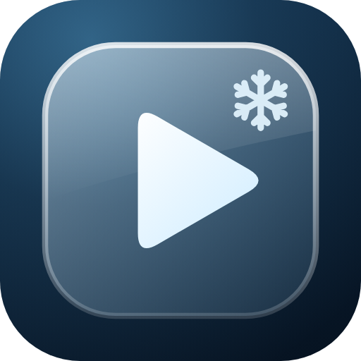

# Frost-flix

**Using the app?** Read the [User guide](USER-GUIDE.md): install, set up and use Frost-flix on your TV.

Frost-flix is a hardened, standalone copy of [Glassio](https://github.com/mohammadmrh12/glassio), an Android TV home screen with a liquid-glass look, made by mohammadmrh12. This copy is based on Glassio **v1.9.3**.

- Package name: `tv.darren.glassio` (installs alongside the original, never over it)
- App label: **Frost-flix** (called "Glassio (D)" up to 1.9.3-d3; the package name stayed the same, so updates install over it)
- Version: 1.9.3-d14

## What is different

Everything that needed adb, installed packages, ran a local server, streamed Apple's aerial feed, imported files from outside the app or sent data to a webhook has been removed. Settings are entered on the TV only. See [CHANGES.md](CHANGES.md) for the full list.

## Install and release

See [SETUP.md](SETUP.md): creating the signing key on Windows, the four GitHub secrets, tagging a release, and installing on an NVIDIA Shield with Downloader.

## Credits and licence

- Original app: see [CREDITS.md](CREDITS.md).
- Licence: GPL-3.0, see [LICENSE](LICENSE). The source of every release is this repository.
- The original README is kept in [docs/upstream/README.md](docs/upstream/README.md). It describes some features this copy no longer has.
